# Mundialito de Fútbol Corporativo

Prueba técnica para desarrollador .NET mid level. Sistema de gestión de un torneo de fútbol
con Clean Architecture, CQRS (EF Core para escritura, Dapper para lectura), Unit of Work,
Result Pattern, idempotencia en POST, observabilidad y frontend en Next.js.

## Estructura

```
backend/
  Mundialito.slnx
  Directory.Build.props        # configuración de compilación compartida
  global.json                  # versión del SDK (.NET 10)
  .config/dotnet-tools.json    # herramienta local dotnet-ef
  src/
    Mundialito.Domain          # entidades, reglas de negocio, eventos, Result
    Mundialito.Application     # casos de uso (commands/queries), contratos
    Mundialito.Infrastructure  # EF Core, Dapper, Unit of Work, migraciones, seed
    Mundialito.Api             # endpoints REST, middleware, composición
  tests/
    Mundialito.UnitTests       # xUnit + Shouldly + NSubstitute (SQLite en memoria para persistencia)
    Mundialito.IntegrationTests# API completa contra SQL Server real (Testcontainers, requiere Docker)
frontend/                      # Next.js 16 (App Router, TypeScript, Tailwind); ver frontend/README.md
docs/                          # ARCHITECTURE.md con diagramas (capas, flujo, observabilidad, despliegue) + SVG
postman/                       # colección (51 peticiones con pruebas) y entornos; ver postman/README.md
```

Regla de dependencias (verificada por pruebas de arquitectura):
`Domain` no depende de nadie, `Application` solo de `Domain`, `Infrastructure` implementa los
contratos de `Application`, y `Api` solo compone y orquesta.

## Arquitectura

El documento [docs/ARCHITECTURE.md](docs/ARCHITECTURE.md) contiene los diagramas (capas y
dependencias, flujo de un command con idempotencia y Unit of Work, observabilidad, despliegue en
Docker), el modelo de datos y las decisiones de diseño con sus alternativas.



## Criterios de evaluación: dónde está cada cosa

| Criterio | Implementación | Verificación |
|---|---|---|
| Clean Architecture | 4 proyectos con referencias unidireccionales (`backend/src`) | `Architecture/LayerDependencyTests` |
| CQRS | `ICommand`/`IQuery`, handlers separados, dispatcher propio (`Application/Abstractions/Messaging`) | `Architecture/CqrsSeparationTests` |
| EF Core (escritura) | `Infrastructure/Persistence`: DbContext, configuraciones, repositorios, 3 migraciones | `UnitOfWorkTests`, integración |
| Dapper (lectura) | `Infrastructure/ReadModel`: SQL parametrizado, paginación en BD, whitelist de orden | `SqlQueryHelpersTests`, `SortWhitelistConsistencyTests`, integración |
| Unit of Work | `Infrastructure/Persistence/UnitOfWork.cs`: transacción, auditoría, eventos, 409 | `UnitOfWorkTests`, `DomainEventTraceabilityTests` |
| Result Pattern | `Domain/Common/Result.cs`, mapeo HTTP en `Api/Common/ResultExtensions.cs` | `ResultTests`, `ResultExtensionsTests` |
| REST + idempotencia | Endpoints por módulo en `Api/Endpoints`; `Api/Idempotency` + tabla `IdempotencyKeys` | `IdempotencyMiddlewareTests`, `IdempotencyStoreTests`, Postman carpeta 2 |
| Observabilidad | Serilog JSON, `CorrelationIdMiddleware`, OpenTelemetry (`Api/Telemetry`), `DomainEventLogs` | `CorrelationIdMiddlewareTests`, `TracingBehaviorTests`, Jaeger |
| Lógica del torneo | `Domain/Tournament/StandingsCalculator.cs`, goleadores en `TournamentReadStore` | `StandingsCalculatorTests`, integración |
| Filtros y paginación | `PagedQueryValidator`, `PagedResult`, read stores | `PagedResultTests`, `QueryValidatorTests`, Postman |
| Tests | 333 unitarias + 11 de integración (Testcontainers) | `backend/tests/README.md` |
| Seed | `Infrastructure/Seeding/DatabaseSeeder.cs` al iniciar si la BD está vacía | `DatabaseSeederTests` |
| Frontend | `frontend/` Next.js 16 con cliente desacoplado | `npm run build`, `npm run lint` |
| Docker | `backend/Dockerfile`, `frontend/Dockerfile`, `docker-compose.yml` | `docker compose up --build` |
| Postman | `postman/` 51 peticiones con 160 aserciones | `newman run` |

## Requisitos

- .NET SDK 10
- SQL Server 2022 (local o en Docker)
- Node.js 20+ (frontend)
- Docker y Docker Compose

## Configuración de la base de datos

La API lee la cadena de conexión de `ConnectionStrings:Database`. En desarrollo se guarda con
user secrets para que nunca entre al repositorio:

```bash
cd backend
dotnet user-secrets set "ConnectionStrings:Database" "Server=localhost,1433;Database=Mundialito;User Id=sa;Password=<clave>;TrustServerCertificate=True" --project src/Mundialito.Api
```

Crear o actualizar el esquema con las migraciones de EF Core (la herramienta `dotnet-ef` se
restaura desde el manifiesto local):

```bash
dotnet tool restore
dotnet ef database update --project src/Mundialito.Infrastructure --startup-project src/Mundialito.Api --connection "Server=localhost,1433;Database=Mundialito;User Id=sa;Password=<clave>;TrustServerCertificate=True"
```

Agregar una migración nueva tras cambiar el modelo:

```bash
dotnet ef migrations add <Nombre> --project src/Mundialito.Infrastructure --startup-project src/Mundialito.Api --output-dir Persistence/Migrations
```

## Inicialización y datos de prueba

Al arrancar, la API espera a que la base responda (con reintentos, pensado para Docker) y luego:

| Opción (`appsettings` o variable de entorno) | Por defecto | Efecto |
|---|---|---|
| `Database:ApplyMigrationsOnStartup` | `false` | Aplica las migraciones pendientes antes de servir tráfico |
| `Database:SeedOnStartup` | `true` | Si no hay equipos, inserta 4 equipos, 5 jugadores por equipo y 6 partidos (3 con resultado) |

El seed vive en `Infrastructure/Seeding` y usa los mismos agregados y el mismo Unit of Work que
la API, así que genera eventos de dominio y filas de auditoría igual que una petición real. Con
él, la tabla de posiciones y los goleadores se pueden consultar de inmediato.

## Ejecutar el backend

```bash
cd backend
dotnet build
dotnet test tests/Mundialito.UnitTests          # sin dependencias externas
dotnet test tests/Mundialito.IntegrationTests   # requiere Docker (levanta SQL Server con Testcontainers)
dotnet run --project src/Mundialito.Api
```

El detalle de qué cubre cada proyecto de pruebas y el mapa contra el enunciado está en
[backend/tests/README.md](backend/tests/README.md).

La API queda en `http://localhost:5000`.

| Ruta | Descripción |
|---|---|
| `GET /health` | Estado de la API y de la base de datos (JSON) |
| `GET /scalar/v1` | Documentación interactiva de la API (solo en desarrollo) |
| `GET /openapi/v1.json` | Documento OpenAPI (solo en desarrollo) |

Cada respuesta incluye las cabeceras `X-Correlation-Id` (se respeta la enviada por el cliente) y
`X-Trace-Id`. Los errores siguen RFC 9457 (ProblemDetails) con `code` en inglés, mensaje en
español en `detail`, y `errors` por campo cuando falla la validación.

### Trazas distribuidas (OpenTelemetry)

Cada petición genera una traza con spans anidados: la petición HTTP, cada command o query de la
capa de aplicación (con el código de error como etiqueta si falla), cada comando SQL (EF Core y
Dapper) y las llamadas HTTP salientes. Los eventos de dominio aparecen como anotaciones del span
y el `correlation.id` queda como etiqueta buscable. El `TraceId` de la traza es el mismo que viaja
en la cabecera `X-Trace-Id` y en los logs.

La exportación usa OTLP y se activa con `OpenTelemetry:OtlpEndpoint` (variable de entorno
`OpenTelemetry__OtlpEndpoint`). En desarrollo apunta a `http://localhost:4317`; para ver las
trazas, levantá Jaeger:

```bash
docker run -d --name jaeger -p 16686:16686 -p 4317:4317 jaegertracing/jaeger:latest
```

y abrí `http://localhost:16686` con el servicio `Mundialito.Api`. Sin backend disponible la API
sigue funcionando: las trazas simplemente no se envían. De las sentencias SQL se exporta solo el
texto parametrizado, nunca los valores de los parámetros.

### Idempotencia en POST

Los endpoints de creación exigen la cabecera `Idempotency-Key` (1 a 128 caracteres: letras,
números, `-`, `_`, `.`, `:`). La llave se persiste en la tabla `IdempotencyKeys` junto con un hash
del método, la ruta y el cuerpo, y con la respuesta original.

| Situación | Respuesta |
|---|---|
| Primera vez | Se ejecuta la operación y se guarda la respuesta |
| Misma llave y mismo cuerpo | Se devuelve la respuesta guardada, con `Idempotent-Replayed: true`, sin ejecutar nada |
| Misma llave y otro cuerpo | `409 Idempotency.PayloadMismatch` |
| Misma llave mientras la primera sigue en curso | `409 Idempotency.RequestInProgress` |
| Sin cabecera | `400 Idempotency.KeyRequired` |

Las llaves se conservan 24 horas. Un error 5xx libera la llave para permitir el reintento.

### Eventos de dominio y trazabilidad

`TeamCreatedDomainEvent` y `MatchResultRegisteredDomainEvent` se levantan en las entidades y el
Unit of Work los despacha dentro de la misma transacción que el cambio. Cada evento produce una
línea de log estructurada y una fila en la tabla `DomainEventLogs` con tipo, agregado, carga JSON,
`CorrelationId` y `TraceId` de la petición que lo originó. Si la transacción se revierte, el
evento tampoco queda registrado. La bitácora se consulta en `GET /api/domain-events` con filtros
por tipo, agregado y correlación.

### Concurrencia optimista

Teams, Players y Matches tienen una columna `RowVersion` (rowversion de SQL Server). Los GET por
id devuelven la cabecera `ETag` y el campo `rowVersion` en el cuerpo. PUT y PATCH aceptan
`If-Match` con ese valor: si otro usuario modificó el registro entre la lectura y la escritura, la
API responde `409 Concurrency.Conflict` y el cliente debe recargar. Sin `If-Match`, la escritura
procede sin esa verificación. Las violaciones de índice único por carreras concurrentes también
responden `409` (`Database.UniqueViolation`).

## Ejecutar el frontend

```bash
cd frontend
npm install
npm run dev
```

Queda en `http://localhost:3800` y consume la API de `http://localhost:5000` (configurable con
`NEXT_PUBLIC_API_URL`). Vistas: tabla de posiciones, goleadores, equipos (con integrantes y
registro), partidos (con filtros y programación) y registro de resultados.

## Docker Compose (todo el sistema con un comando)

```bash
cp .env.example .env     # ajustar DB_PASSWORD; los puertos tienen valores por defecto
docker compose up --build
```

| Servicio | Imagen | Puerto en el host |
|---|---|---|
| `db` | SQL Server 2022 | `14333` (no choca con una instancia local en 1433) |
| `api` | `backend/Dockerfile` (multi-stage, .NET 10) | `5000` → `http://localhost:5000/scalar/v1` |
| `frontend` | `frontend/Dockerfile` (Next.js standalone) | `3800` → `http://localhost:3800` |
| `jaeger` | Jaeger (perfil `observability`) | `16686` |

La API espera a que la base esté sana, aplica las migraciones pendientes y siembra los datos de
prueba; el frontend arranca cuando la API responde en `/health`. Para ver las trazas:
`docker compose --profile observability up --build` y abrir `http://localhost:16686`.

Detener y conservar los datos: `docker compose down`. Detener y borrar la base:
`docker compose down -v`.

## Variables de entorno

Copiar `.env.example` a `.env` y ajustar los valores. El archivo `.env` no se versiona y lo
consume Docker Compose. En desarrollo local la API usa user secrets (ver arriba) y el frontend
`frontend/.env.development`.
