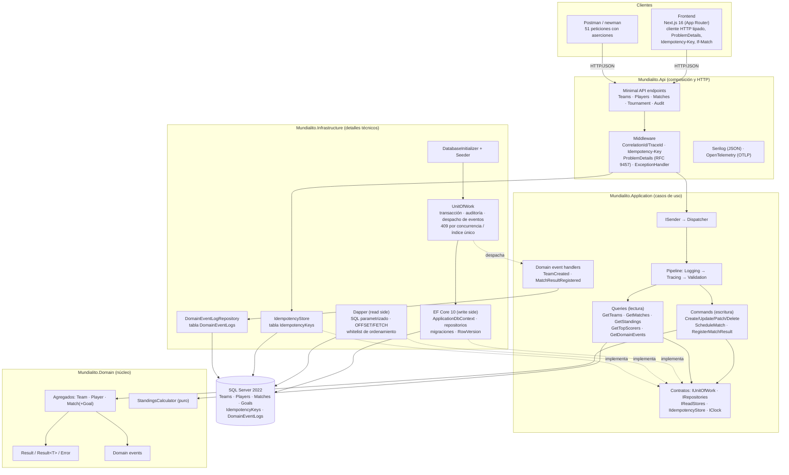
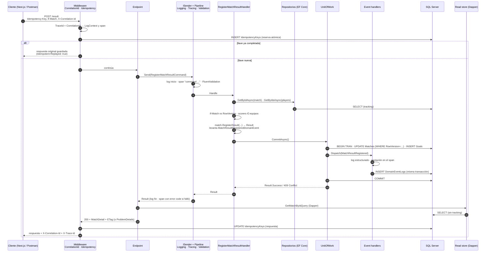
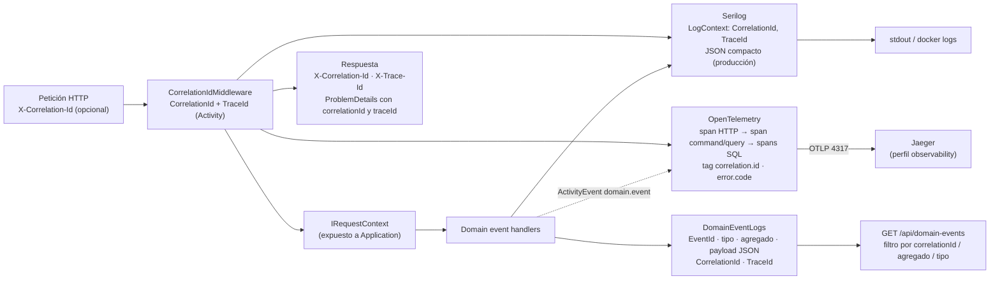
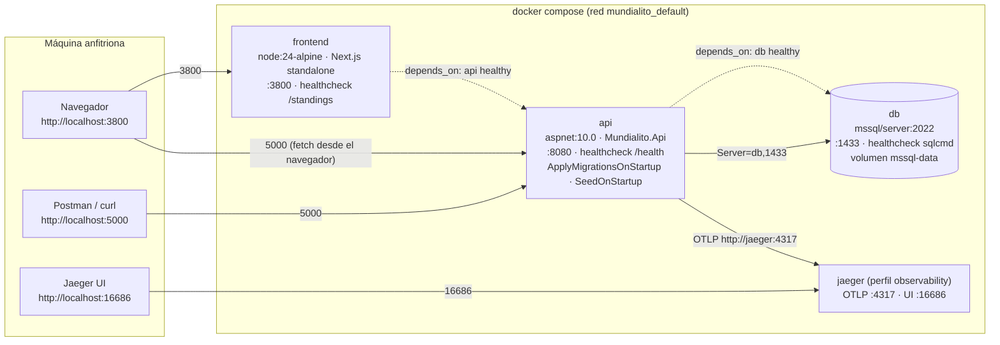

# Arquitectura

Sistema de gestión del Mundialito de Fútbol Corporativo. Backend en .NET 10 con Clean
Architecture y CQRS, frontend en Next.js 16, SQL Server 2022, todo orquestado con Docker Compose.
Los diagramas están en Mermaid (se renderizan en GitHub) y exportados a SVG en `docs/diagrams/`.

## 1. Capas y dependencias

Regla: las dependencias apuntan hacia adentro. `Domain` no conoce a nadie; `Application` solo a
`Domain`; `Infrastructure` implementa los contratos de `Application`; `Api` compone y traduce
HTTP. Una prueba de arquitectura (`LayerDependencyTests`) falla si alguna capa viola la regla.

| Capa | Responsabilidad | Depende de |
|---|---|---|
| `Mundialito.Domain` | Entidades con invariantes, eventos de dominio, Result Pattern, cálculo de la tabla | nada |
| `Mundialito.Application` | Commands y queries, pipeline (logging, trazas, validación), contratos, handlers de eventos | Domain |
| `Mundialito.Infrastructure` | EF Core (escritura), Dapper (lectura), Unit of Work, idempotencia, auditoría, seed | Application |
| `Mundialito.Api` | Endpoints, middleware, ProblemDetails, Serilog, OpenTelemetry, composición | Application, Infrastructure |

## 2. CQRS

| | Escritura (commands) | Lectura (queries) |
|---|---|---|
| Tecnología | EF Core 10 con tracking | Dapper con SQL parametrizado |
| Entrada | `ICommand` / `ICommand<T>` | `IQuery<T>` |
| Acceso a datos | Repositorios + `IUnitOfWork` | Read stores (`ITeamReadStore`, `IMatchReadStore`, …) |
| Resultado | `Result` / `Result<Guid>` | `Result<PagedResult<T>>` o `Result<T>` |
| Garantía | Transacción única, eventos, concurrencia optimista | Paginación y ordenamiento en SQL, sin cargar todo en memoria |

Una prueba de arquitectura (`CqrsSeparationTests`) verifica que ningún query handler reciba un
repositorio, el Unit of Work ni EF Core. Tras un command, el endpoint vuelve a leer la
representación por el lado de lectura: escritura y lectura conviven en una misma petición sin
mezclarse.

## 3. Flujo de un command

Registro de resultado, el caso más completo: idempotencia, concurrencia optimista, reglas de
dominio, Unit of Work, eventos y trazabilidad.

### Unit of Work

`CommitAsync` es el único punto donde los cambios llegan a la base. Dentro de una transacción:
sella `CreatedAtUtc`/`UpdatedAtUtc`, guarda, despacha los eventos de dominio (cuyos handlers
pueden agregar más filas, que se guardan en la misma transacción) y confirma. Devuelve
`Result<int>`: un conflicto de concurrencia (`DbUpdateConcurrencyException`) o una violación de
índice único se traducen a errores 409 sin excepciones hacia arriba; un fallo de infraestructura
revierte todo y se propaga.

### Idempotencia

`Idempotency-Key` es obligatoria en todo POST que crea. La llave se reserva con un INSERT
(la clave primaria hace la reserva atómica frente a peticiones concurrentes), el handler corre
con la respuesta capturada en memoria y al terminar se guarda estado, cuerpo, content-type y
`Location`. Una repetición devuelve exactamente lo guardado. La misma llave con otro cuerpo
responde 409; un 5xx libera la llave. Las llaves expiran a las 24 horas.

### Concurrencia optimista

`Teams`, `Players` y `Matches` tienen `RowVersion` (rowversion de SQL Server). Los GET por id
devuelven `ETag`; PUT, PATCH y el registro de resultado aceptan `If-Match`. El handler compara
la versión esperada con la cargada y EF Core la vuelve a comparar en el `WHERE` del UPDATE; ambas
rutas terminan en `409 Concurrency.Conflict`.

## 4. Observabilidad y trazabilidad

- **Logs estructurados** con Serilog: JSON compacto en producción, texto en desarrollo. Niveles:
  Debug (inicio de handler, commit), Information (fin de handler, eventos, petición HTTP con
  duración), Warning (fallos de negocio, conflictos), Error (excepciones). Nunca se registran
  cuerpos de petición ni valores de parámetros SQL.
- **Trazas** con OpenTelemetry: ASP.NET Core, HttpClient, SqlClient y un span por command/query
  con el código de error como etiqueta. Exportación OTLP opcional a Jaeger.
- **Eventos de dominio**: `TeamCreatedDomainEvent` y `MatchResultRegisteredDomainEvent`, con
  handler que escribe log y fila de auditoría dentro de la transacción del cambio. La tabla tiene
  la forma de un outbox: si hiciera falta un bus externo, un proceso la leería y publicaría.

## 5. Despliegue con Docker Compose

Orden de arranque: `db` sano (sqlcmd) → `api` aplica migraciones pendientes y siembra si la base
está vacía → `frontend` cuando `/health` responde. La URL de la API se incrusta en el bundle del
frontend en tiempo de build porque el navegador la llama por el puerto publicado en el host.

## 6. Modelo de datos

| Tabla | Propósito | Notas |
|---|---|---|
| `Teams` | Equipos | `Name` y `Code` únicos, `IsActive` (baja lógica), `RowVersion` |
| `Players` | Integrantes | FK a `Teams` (cascade), dorsal único por equipo, `Position` como entero |
| `Matches` | Partidos | Dos FK a `Teams` (restrict), check `HomeTeamId <> AwayTeamId`, `Status`, marcador nulo hasta finalizar |
| `Goals` | Goles | Hijo del agregado `Match` (cascade), FK a `Players` y `Teams` (restrict) |
| `IdempotencyKeys` | Idempotencia | PK = llave, hash de la petición, respuesta serializada, expiración |
| `DomainEventLogs` | Auditoría | Solo inserción; índices por fecha, agregado, tipo y correlación |

Claves primarias `Guid` versión 7 generadas en el dominio. Fechas en UTC con sufijo `Utc`.

## 7. Decisiones principales

| Decisión | Alternativa descartada | Motivo |
|---|---|---|
| Dispatcher CQRS propio (60 líneas) | MediatR | Licencia comercial desde 2025; el patrón es simple y así se demuestra |
| Tabla calculada en el dominio, goleadores en SQL | Ambos en SQL | Las reglas de puntos se prueban sin base; la agregación de goles la hace mejor el motor |
| Concurrencia optimista con rowversion | Bloqueo pesimista | Sin esperas ni deadlocks; 409 claro para el cliente |
| Eventos despachados dentro de la transacción | Despacho tras commit / bus externo | Atomicidad entre cambio y auditoría; la tabla ya sirve de outbox |
| Mensajes en español desde la API, códigos en inglés | Traducción en el frontend | Una sola fuente de verdad; Postman legible |
| SQLite en memoria para pruebas de persistencia + Testcontainers para integración | Proveedor InMemory | InMemory no tiene transacciones ni restricciones |
